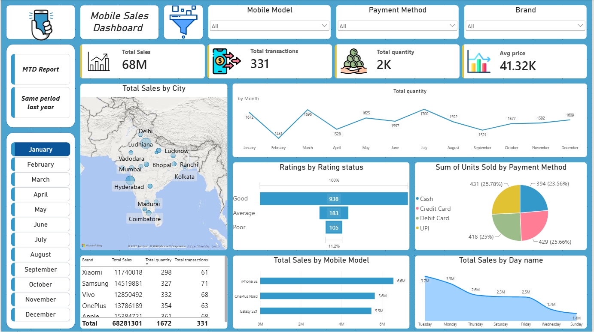
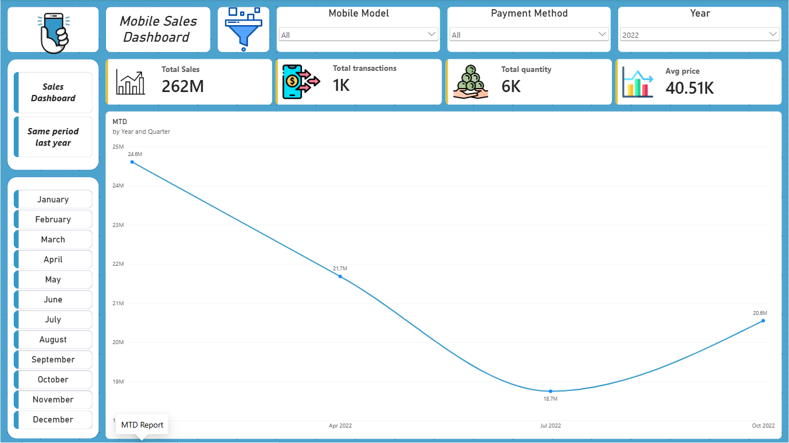
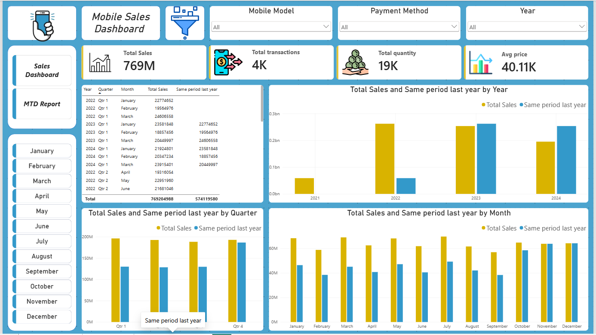

# 📱 Mobile Sales Dashboard (Power BI)

An interactive 3-page Power BI dashboard analyzing **3,835 mobile phone transactions across 19 Indian cities** (Oct 2021 – Oct 2024), covering 5 brands and 15 phone models.

## Headline Numbers

| Metric | Value |
|---|---|
| Total Sales | ₹769M |
| Transactions | 3,835 |
| Units Sold | 19,150 |
| Avg Price per Unit | ₹40.11K |

## Dashboard Pages

1. **Sales Dashboard**: total sales vs. same period last year by year, quarter and month, with a detail table and slicers for Mobile Model, Payment Method and Year.
2. **MTD Report**: month-to-date sales trend by year and quarter.
3. **Monthly Deep Dive**: city-wise sales map, monthly quantity trend, customer rating split, payment method mix, sales by mobile model and by day of week, with a Brand slicer and month buttons.

## Key Insights

- **Delhi and Mumbai drive the business.** Together they account for about 43% of sales (Delhi 26.5%, Mumbai 16.5%). No other city is above 4.1%.
- **Brand competition is tight.** Apple leads with 21.0% of sales, followed by Samsung (20.8%), OnePlus (20.0%), Vivo (19.5%) and Xiaomi (18.7%). The gap between first and last is only about 2 points.
- **UPI is the most-used payment method** (26.2% of sales), but all four methods sit between 24% and 26%.
- **Best-selling model:** iPhone SE (7.7% of sales), followed by OnePlus Nord and Galaxy Note 20.
- **Customer satisfaction is positive.** The average rating is 3.7 out of 5, with about 61% of ratings at 4 or 5 stars and 22% at 1 or 2.
- **Saturday is the strongest sales day** and Wednesday the weakest.
- **Like-for-like trend is flat to slightly down.** Comparing Jan–Sep only, sales were ₹197.5M in 2022, ₹190.2M in 2023 (-3.7%) and ₹188.8M in 2024 (-0.8%).

## Data Notes

- The dataset starts in **October 2021** and ends in **October 2024** (only part of that month), so 2021 and 2024 are partial years. Their year-level bars look low because of coverage, not because of a collapse in demand. Use the Jan–Sep comparison above for a fair read.
- The `Day Name` column mixed full and abbreviated names (e.g. "Saturday" and "Sat"), which were standardized during cleaning.
- Avg Price is the simple average of `Price Per Unit` across transactions.
- Total Sales = `Units Sold × Price Per Unit`.

## Skills Demonstrated

Data cleaning (Power Query) · Data modeling · DAX time intelligence (same period last year, month-to-date) · KPI cards · Slicers · Map, pie, funnel, line and bar visuals · Page navigation buttons

## Tools

Power BI Desktop · Power Query · DAX

## Dataset

Mobile sales dataset with 3,835 transactions and 14 columns, covering October 2021 to October 2024 across 19 Indian cities, 5 brands and 15 phone models. The data is embedded in the `.pbix` file.

| Column group | Fields |
|---|---|
| Transaction | Transaction ID, Day, Month, Year, Day Name |
| Product | Brand, Mobile Model, Units Sold, Price Per Unit |
| Customer | Customer Name, Customer Age, City, Customer Ratings |
| Payment | Payment Method |

## How to Open

1. Download `mobile_sales.pbix`
2. Open it in **Power BI Desktop** (free from Microsoft)

## Author

**[Your name]** · [LinkedIn URL]
